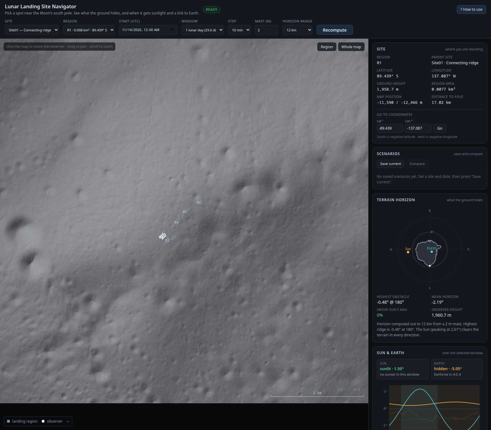
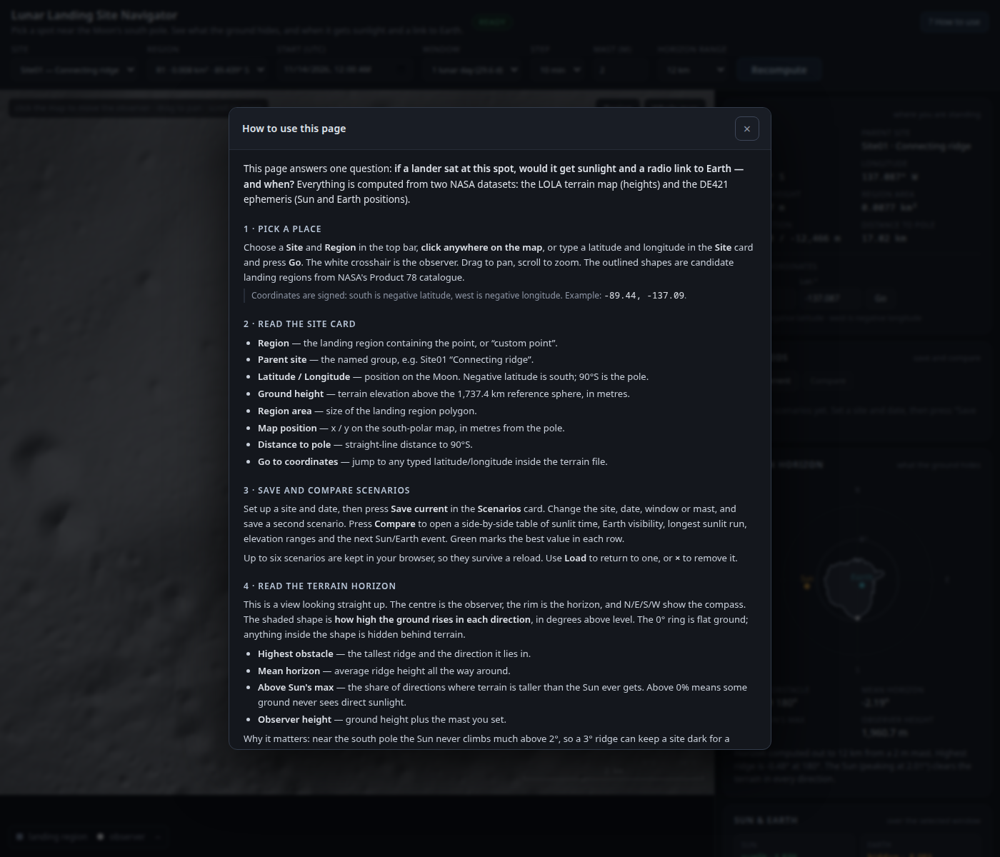
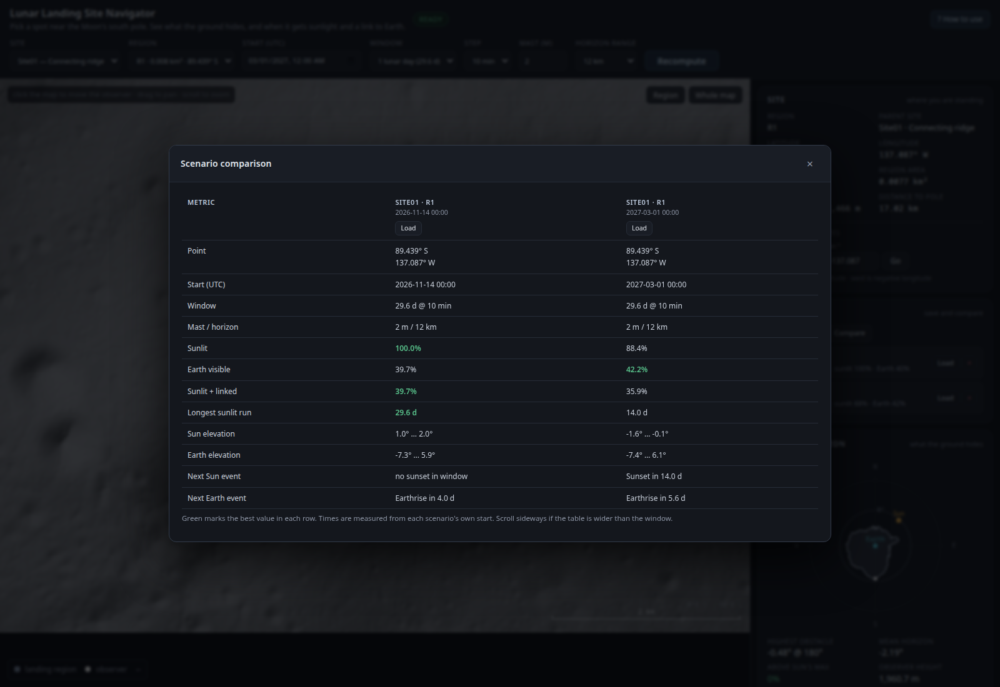

# Lunar Landing Site Navigator

A small, self-contained tool for asking three questions about a candidate
lunar south-pole landing site:

1. **What does the ground look like?** — LOLA terrain, 20 m per pixel.
2. **What can you actually see?** — the terrain horizon in every direction.
3. **When is there sunlight and a link to Earth?** — Sun and Earth positions
   from NASA's DE421 ephemeris, tested against that horizon.

Everything runs locally. No API keys, no CDN, no internet at run time.



*The built-in guide, also available via **? How to use**:*



---

## Quick start

```bash
cd ~/Desktop/app-space

./bin/python scripts/preflight.py     # are the data files here and intact?
./bin/python scripts/selfcheck.py     # do the numbers still make sense?
./bin/python server.py                # http://127.0.0.1:8000
```

Then open <http://127.0.0.1:8000>.

If the virtualenv or the packages are missing:

```bash
python3 -m venv .
./bin/pip install -r requirements.txt
```

---

## What the interface does

**Map.** South-polar stereographic view of the terrain, with the Product 78
region-of-interest polygons on top. Drag to pan, scroll to zoom, click anywhere
to move the observer, or type a latitude/longitude in the Site card and press
**Go**. The white crosshair is the observer.

**Scenarios.** Press **Save current** to remember a site + date + settings, then
change something and save again. **Compare** opens a side-by-side table of
sunlit time, Earth visibility, longest sunlit run, elevation ranges and the next
Sun/Earth event, with the best value in each row marked green. Up to six
scenarios are kept in the browser.



**Terrain horizon.** A polar plot of the highest terrain angle in each
compass direction, computed by casting rays from the observer out to the chosen
range and taking the maximum elevation angle (curvature included). This is the
part that decides whether a low Sun is visible — near the pole the Sun never
climbs more than about 2°, so a 3° ridge is the difference between power and
darkness.

**Sun & Earth.** Two boxes above the chart give the *now / next* summary: is the
Sun up or the Earth visible at the start of the window, at what elevation, and
how long until the next sunset, sunrise, earthset or earthrise. Below them, Sun
and Earth elevation are plotted over the selected window with the terrain horizon
drawn as a dashed line. Where the solid line is above the dashed line, the body
is visible; where it is below, the terrain hides it. The amber background is
sunlight, the cyan background is an Earth link.

The numbers below the chart are the summary: fraction of time sunlit, fraction
of time the Earth is visible, the longest continuous sunlit run, and every
horizon crossing in the window.

### Reading the Site card

| Field | What it means |
|---|---|
| **Region** | The landing region containing the point, or “custom point”. |
| **Parent site** | The named group, e.g. Site01 “Connecting ridge”. |
| **Latitude / Longitude** | Position on the Moon. Negative latitude is south; 90°S is the pole. |
| **Ground height** | Terrain elevation above the 1,737.4 km reference sphere, in metres. |
| **Region area** | Size of the landing region polygon. |
| **Map position** | x / y on the south-polar map, in metres from the pole. |
| **Distance to pole** | Straight-line distance to 90°S. |

### Reading the horizon plot

The plot is a view looking straight up: the centre is the observer, the rim is
the horizon, and N/E/S/W show the compass. The shaded shape is how high the
ground rises in each direction, in degrees above level. The 0° ring is flat
ground; anything inside the shape is hidden behind terrain.

- **Highest obstacle** — the tallest ridge and the direction it lies in.
- **Mean horizon** — average ridge height all the way around.
- **Above Sun's max** — the share of directions where terrain is taller than the
  Sun ever gets. Above 0% means some ground never sees direct sunlight.
- **Observer height** — ground height plus the mast you set.

### While it is calculating

Clicking a new point or changing a control starts a request. The page shows this
in four places at once: the status pill in the header turns amber with a spinner,
a thin progress bar appears under the header, a “calculating…” chip appears on
the map, and the two chart cards dim behind a spinner. The dashed amber ring
around the observer marks the point being evaluated. When the request finishes
the pill turns green (“ready”) and the Sun & Earth card reports the timestamp and
how long the calculation took.

The full guided explanation is built into the page: click **? How to use** in
the top-right corner (it also opens automatically the first time you visit).
Direct link: <http://127.0.0.1:8000/?help=1>.

### Things worth trying

| What | Why it is interesting |
|---|---|
| Window → *1 lunar day* | Watch the Earth swing ±6° through the lunar sky |
| Start → `2027-03-01` | Near the equinox: the Sun actually sets and rises |
| Mast → 10 m | See how much a taller antenna buys you |
| Horizon range → 50 km | Distant massifs start to matter |
| Click a different ROI | Each region has a different horizon |
| Save two dates, then **Compare** | See the power/communication trade-off side by side |
| Type `-89.5, 30` and press **Go** | Jump to any point without hunting on the map |

At Site01 in November the Sun never sets (southern summer) and the Earth is
below the horizon, so the default view shows 100% sunlit / 0% Earth. That is
the real answer, not a bug — move the date to March to see both change.

### How this maps to the challenge

| Challenge objective | How the app addresses it |
|---|---|
| Intuitive tool for planners, educators, public | One screen, plain-language labels, built-in guide, tooltips |
| Compare landing sites and dates quickly | **Scenarios** card saves up to six site/date combinations; **Compare** shows a side-by-side table |
| Curated site list + custom coordinates | Product 78 regions in the Site/Region menus; typed lat/lon or map click for any point in the 608 km DEM |
| Date and time flexibility | UTC start, 1 day / 7 day / 1 lunar day windows, 5–60 min sampling |
| Sun and Earth relative to the horizon | Polar horizon plot + timeline with dashed terrain horizon |
| Time before sunset / Earthset | **Now / next** boxes above the chart give the next event and time remaining |
| Solar elevation, sunlight duration, Earth windows | Elevation chart and range, sunlit %, longest run, Earth-visible %, crossing list |
| Multiple visualizations | 2D terrain map, polar sky view, time-series chart, comparison table |
| Temporal dynamics | Full-window timeline; hover any moment for exact values |
| LOLA topography, no atmosphere | 20 m DEM, ray-cast horizon with lunar curvature, no refraction |
| Earth libration / orbital variation | DE421 + lunar orientation kernel |
| Steep slopes and craters | Resolved by the DEM and included in the horizon; no separate hazard layer |

**Not included by design:** 5 m terrain add-ons, slope/hazard rasters, 3D fly-through,
and non-polar Apollo/CLPS sites (outside this DEM). See **Limits** below.

---

## How it works

```
LDEM_80S_20MPP_ADJ.TIF          20 m/px heights, MOON_ME_DE421
        │
        ├── hillshade  ──────────────► map canvas
        ├── height at a point ───────► site card
        └── ray cast ────────────────► terrain horizon (360 values)
                                              │
de421.bsp ─┐                                  │
moon_pa_de421_1900-2050.bpc ─┤                │
moon_080317.tf ──────────────┼──► Sun/Earth   │
naif0012.tls ────────────────┘    elevation ──┴──► lit? linked?  ──► charts
```

The terrain and the ephemeris meet in one place: the **1737.4 km sphere**. The
DEM's heights are metres above that sphere, the site's local up/east/north
vectors are built on it, and SPICE returns Sun and Earth vectors in the
`MOON_ME_DE421` frame that the DEM was registered in. Mixing an ellipsoid in
here would put the two halves of the app in different frames.

### Frame and time notes

- Terrain frame: `MOON_ME_DE421` (alias `MOON_ME`). Defined by `moon_080317.tf`.
- Ephemeris: `de421.bsp`, valid 1899-07-28 → 2053-10-08.
- Lunar orientation: `moon_pa_de421_1900-2050.bpc`, valid 1900 → 2050.
- Times are UTC. `naif0012.tls` supplies leap seconds.
- Sun visibility uses the **upper limb** (radius 0.266°); Earth visibility
  treats the Earth as a point.

---

## API

All endpoints return JSON with `ok: true`, or `{ok: false, error: "..."}` with
HTTP 400/500.

| Endpoint | Parameters | Returns |
|---|---|---|
| `GET /api/status` | — | file paths, sizes vs published sizes, kernel list, warnings |
| `GET /api/sites` | — | sites and ROI polygons (projected metres + lon/lat + height) |
| `GET /api/raster` | `cx cy span w h [sun_az sun_el]` | PNG hillshade; extent in the `X-BBox` header |
| `GET /api/point` | `x y` | lon, lat, terrain height |
| `GET /api/skyline` | `x y [maxdist mast az_step]` | `az[]`, `elev[]`, max/mean horizon |
| `GET /api/profile` | `x y az [maxdist mast step]` | ground height and elevation along one bearing |
| `GET /api/ephemeris` | `x y [start hours step_min maxdist mast]` | `t[]`, `sun_el[]`, `sun_az[]`, `earth_el[]`, `earth_az[]`, `sun_sky[]`, `earth_sky[]`, `lit[]`, `earth_vis[]`, stats |

Example:

```bash
curl "localhost:8000/api/skyline?x=-11589.9&y=-12466.4&maxdist=12000&mast=2"
```

---

## Project layout

```
server.py                 Flask app + JSON API
lunar/
  config.py               where the data files live (env-var overridable)
  geo.py                  sphere maths, projection helpers, skyline geometry
  dem.py                  terrain: heights, hillshade, skyline, profiles
  roi.py                  dependency-free shapefile reader for the ROI archives
  ephemeris.py            SPICE: Sun/Earth elevation, lit/linked timeline
  sites.py                site catalogue (names from PGDA Product 78)
web/
  index.html, style.css, app.js     the interface (no frameworks)
scripts/
  preflight.py            check the data files
  selfcheck.py            check the physics and the geometry
docs/screenshot.png
explore_datasets.py       earlier standalone CLI, kept for reference
```

Data files are found automatically in the project folder, in `data/`, or in
`/mnt/data`. Override with `LUNAR_DEM`, `LUNAR_KERNELS`, `LUNAR_ROIS`.

---

## Validation

`scripts/selfcheck.py` compares the app against things it cannot fake:

| Check | Expected | Result |
|---|---|---|
| Terrain file size | 2,696,082,051 B (PGDA) | exact |
| Kernel sizes | published bytes | exact |
| Closed-form projection vs pyproj | 0 difference | < 1e-12° |
| Sun at the south pole, 2026-11-14 | +1.56° (Moon's 1.54° tilt) | +1.56° |
| Sun at the south pole, 2027-05-14 | −1.52° | −1.52° |
| Earth–Moon distance, 2026-11-12 | ~404,000 km | 404,148 km |
| Skyline vs brute force over every pixel | same maximum | −0.48° vs −0.49° |
| Skyline vs `profile()` on the same bearing | identical | −0.483° vs −0.483° |
| ROI centre | from the shapefile | −11,589.9 / −12,466.4 m |

The Sun-at-the-pole test is the important one: the Moon's axis is tilted
1.54° to its orbit, so the Sun's elevation measured from the pole *must* swing
between roughly +1.5° and −1.5° over a year. If the frames or the time
conversion were wrong, that number would be wrong.

**Not verified:** the positions have not been differenced against JPL Horizons
call by call. The physical invariants above are strong but they are not the
same thing as a Horizons comparison.

---

## Limits (please read before trusting a number)

- **20 m/px is coarse.** The terrain grid cannot resolve lander-scale slopes or
  boulders. Product 78's 5 m DEMs and slope layers are the right tool for that;
  they are not part of this basic set.
- **No slope or hazard layers.** The app shows heights and horizons only.
- **Only Site01 is on disk.** The catalogue knows all 27 PGDA site names, but
  the interface lists the ones whose `SiteXX_ROIs.tgz` is present.
- **Earth link is geometric.** A point source above the horizon, no antenna
  pattern, no relay spacecraft, no terrain blockage by a lander body.
- **No atmosphere.** Correct for the Moon; refraction is not modelled because
  there is nothing to refract through.
- **Heights are relative to a sphere**, not a geoid — that is what the product
  provides and what the frame expects.
- **Longest sunlit run** is measured inside the selected window; a run that
  starts before the window begins is reported as shorter than it really is.
- **Scenario comparison is browser-local.** Saved scenarios live in
  `localStorage` on this machine and hold summary numbers, not the full curves.
- **Custom coordinates are limited to the DEM footprint** (about 80°S–90°S).
  Points outside that square are rejected with a message.

---

## Adding more sites

Download any other `SiteXX_ROIs.tgz` from
<https://pgda.gsfc.nasa.gov/products/78> into the project folder and reload the
page. The app picks it up automatically, converts its polygons into the terrain
frame, and samples the DEM for each region's height.

## Upgrading to DE440

The basic set uses DE421 because Product 90's terrain is registered in
`MOON_ME_DE421`. A modern equivalent is DE440, but **do not load both FKs at
once** — `moon_080317.tf` and `moon_de440_250416.tf` both define frame IDs
31000/31001 and the later one silently wins. To switch, replace the kernel set
and change `FRAME` in `lunar/config.py`:

```
de440.bsp
moon_pa_de440_200625.bpc
moon_de440_250416.tf
naif0012.tls
```

---

## Troubleshooting

| Symptom | Cause |
|---|---|
| `Terrain file ... not found` | set `LUNAR_DEM=/full/path/LDEM_80S_20MPP_ADJ.TIF` |
| `Missing NAIF kernel(s)` | set `LUNAR_KERNELS=/folder/with/kernels` |
| Map is blank, pill says *backend offline* | the Flask server is not running |
| Map looks blurry when zoomed in | expected: the source is 20 m/px |
| Everything is 100% sunlit | you are near a solstice; try March or September |
| Earth never visible | check the date: libration moves it ±6° over a month |
